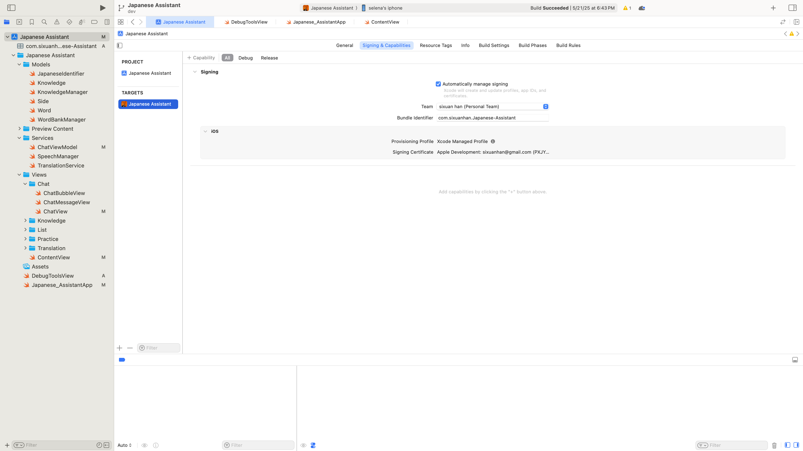

# README: Japanese Assistant

## Overview

Japanese Assistant is a Swift-based iOS application designed to help users learn and manage Japanese language concepts. The app provides features such as chat-based AI assistance, knowledge card management, vocabulary flashcards, and integration with external resources for enhanced learning.

## Updates

The Google Generative AI API has been deprecated recently. New modifications aim to resolve this issue.

## Features

1. **Chat with AI:**
    Ask questions about Japanese grammar, vocabulary, or culture. Receive detailed, structured responses from an AI-powered assistant.
2. **Knowledge Cards:**
    Save AI responses as editable knowledge cards. Organize and manage knowledge cards for future reference. Edit and save changes to knowledge cards dynamically.
3. **Collect and Manage Vocabularies:**
    CRUD, sort, and filter your vocabularies in the "List" tab. Click on them to listen, and search for more details in "Edit".
4. **Practice Vocabularies:**
   Use Anki-style vocabulary memorization technique to refresh your memory in the "Practice" tab.
5. **Translation:**
   Translate between English and Japanese instantly. Copy paste or listen to them.
6. **Cloud Accounts (Firebase Auth + Firestore):**
   Sign up / sign in with an email and password. Each user's word bank and knowledge cards are stored in their own Firestore document (`users/{uid}`) and follow them across devices. Includes change-password, sign-out, and delete-account flows. On first sign-in any data still sitting in UserDefaults is migrated up to Firestore automatically.
7. **Offline-first:**
   The app is fully usable without an internet connection. All reads and writes go through a local UserDefaults cache, so adding/editing words and practicing never blocks on the network. Cloud writes are queued by Firestore and replay automatically once connectivity returns; on the next foreground transition with internet, the app pushes any unsynced local changes to Firestore (or pulls fresh cloud data if there are no pending edits). Sign-up and password operations still require a network connection, but signing in once means the existing session keeps working offline indefinitely.
8. **Vocab Groups:**
   Manually group related words, such as synonyms or easily confused vocabulary, from the Add Word or Edit Word screen. Membership is shared: grouping A with B makes them members of the same group when editing either word. AI-generated notes explain the differences between the selected words.
9. **Phonetic Groups:**
   Automatically group words with the same phonetic when adding a word or changing an existing word's Phonetic field. Add or remove members manually to include similar-sounding words or exclude exact matches.

## Word Groups

### Vocab groups

Use vocab groups to study relationships in meaning or usage:

- Search for and select related words in the **Vocab Group** section of Add Word or Edit Word.
- Save to apply the shared membership; each member can display the other members when edited.
- Membership changes request an AI differentiation note. Existing saved notes are reused when opening the editor.
- Remove members in Edit Word to adjust the group. Groups with no remaining members are cleaned up.

### Phonetic groups

Use phonetic groups to study identical or similar pronunciations, independently of vocab groups. A word can belong to both a vocab group and a phonetic group.

On adding a word or changing its **Phonetic** field, the app searches the word bank:

- If A matches an ungrouped word B, it creates an A + B group.
- If A matches B and C in an existing group, A joins that group.
- If A matches B and C whose group membership is missing, it creates an A + B + C group.
- Changing a word's phonetic removes it from its former phonetic group and matches it against the new phonetic.

Matching ignores surrounding whitespace and normalizes equivalent Unicode representations. It does not automatically equate hiragana, katakana, romaji, or different spellings. Empty phonetics are not grouped.

The **Phonetic Group** section in Add Word and Edit Word previews membership and lets you search for similar-sounding words to add manually. Adding a word that already belongs to a phonetic group brings its group members along. Remove members with the minus button, then Save to apply your choices. Manual removals persist across ordinary edits and practice updates; changing the word's phonetic triggers automatic matching again. Groups with fewer than two members are cleared.

Both group types save locally for offline use and sync through the existing Firebase user-data flow. Automatic phonetic matching and manual membership edits do not require AI or an internet connection; generating vocab-group notes does.

## Installation

1. Clone the repository:

    ```bash
    git clone https://github.com/sixuanhan/JapaneseAssistant.git
    ```

2. Open the project in Xcode.
3. Ensure you have the latest version of Xcode and Swift installed.
4. Change your team and bundle ID to a unique bundle ID under "Signing and Capabilities" in XCode.
   
5. Set up Firebase AI following [this guide](https://firebase.google.com/docs/ai-logic/get-started?hl=zh-cn&api=dev).
6. Find AI Logic in the left-hand menu of your project in your Firebase Console. Follow the prompts to enable AI Logic for your project.
7. In the Firebase Console, enable **Authentication** with the **Email/Password** provider, and create a **Cloud Firestore** database (in test mode for development, then lock down with rules that restrict each user to `users/{request.auth.uid}`).
8. Run the app on a simulator or a connected iOS device.
9. You might run into a 403 error from FirebaseAI the first time you run the app. If that's the case, follow the link provided in the error and enable the Firebase AI Logic API. The link looks like: "https://console.developers.google.com/apis/api/firebasevertexai.googleapis.com/overview?project=<1111111>".

## Dependencies

- SwiftUI: For building the user interface.
- FirebaseAI: For AI-powered chat functionality.
- FirebaseAuth + FirebaseFirestore: For user accounts and cloud-synced word/knowledge data.
- DeepL: For translation. Replace API key in `TranslationService`. Get an API key [here](https://www.deepl.com/en/pro-api?utm_term=&utm_campaign=US%7CPMAX%7CC%7CEnglish&utm_source=google&utm_medium=paid&hsa_acc=1083354268&hsa_cam=21607908173&hsa_grp=&hsa_ad=&hsa_src=x&hsa_tgt=&hsa_kw=&hsa_mt=&hsa_net=adwords&hsa_ver=3&gad_source=1&gad_campaignid=21601196877&gbraid=0AAAAABbqoWDqz0tCSD0Yxn1Cz8U8rNjvu&gclid=Cj0KCQjw2tHABhCiARIsANZzDWoBescJx2hzrKI_Q0zYkHSI3fecNC0P_Ux-u3WODBp4KsRJ8JnNXn4aAtZzEALw_wcB#api-pricing).
- kanjiAlive: For translating Kanji to Hiragana. Replace API key in `TranslationService`. Get an API key [here](https://app.kanjialive.com/api/docs).

## Bundle ID error

This should not happen to you, but if you ever get an error saying that there is a conflict with your bundle ID, that means someone took your bundle ID. If you still have the old app with the conflicted bundle ID installed on your phone, this is what you should do:

1. Go to XCode and connect to your iPhone.
2. In Window -> Devices and Simulators, you should see the old app's identifier in the "INSTALLED APPS" section.
3. Click on that old app, and then click on the ... icon below this section. Click on Download Container. Download it to anywhere you like.
4. Right click on the .xcappdata file. Click on "Show Package Contents".
5. Find AppData -> Library -> Preferences -> the .plist file with your old bundle ID. Copy that to the root directory of your repo.
6. Go to line 23 of DebugToolsView. Change the forResource string to your old bundle ID.
7. Go to Japanese_AssitantApp. Uncomment line 27 and comment line 26.
8. Run the app on your phone. Click on the "Restore Old UserDefaults" button.
9. Once that is successful, Go to Japanese_AssitantApp. Uncomment line 26 and comment line 27.
10. Delete the .plist file you copied over in step 5.
11. Run the app on your phone. You should see all your data. Then you can delete the old app.

## Known Issues

- Since there is no perfect sentence-in-kanji-to-sentence-in-hiragana translating API, the app uses kanjiAlive to translate each Kanji to Hiragana when adding a word. It is rarely accurate, so please always check the Hiragana to make sure it is correct.

## Future Enhancements

- Add support for exporting knowledge cards as PDFs or text files.
- Integrate directly with Duolingo.

## Contributing

1. Fork the repository.
2. Create a new branch for your feature or bug fix:

   ```bash
   git checkout -b feature-name
   ```

3. Commit your changes:

   ```bash
   git commit -m "Add feature-name"
   ```

4. Push to your branch:

    ```bash
    git push origin feature-name
    ```

5. Submit a pull request.
